# ⚖️ Awesome Contract Risk Assessment & Mitigation

  <strong>Curated Directory of Enterprise SaaS Solutions &amp; Open-Source Legal Tech Repositories</strong> 
  <em>Focused on Clause-Level Risk Scoring, Legal Playbook Enforcement, Automated Redlining &amp; Pre-Signature Contract Intelligence</em>

  <a href="#-table-of-contents">Table of Contents</a> •
  <a href="#-sector-overview--market-dynamics">Sector Overview</a> •
  <a href="#-saashosted-platforms">SaaS Platforms</a> •
  <a href="#-open-source-github-projects">Open-Source Projects</a> •
  <a href="#-support--sponsor">Support</a>

---

## 📌 Executive Summary & SEO Keywords

Welcome to the **Awesome Contract Risk Assessment & Mitigation** repository—the central curated index for **LegalTech engineers**, **corporate legal departments**, **procurement risk specialists**, and **contract attorneys**. 

Modern enterprise agreements demand automated scrutiny. Rather than discovering liabilities post-execution, this repository indexes the best-in-class platforms and developer tools capable of:
* 🔍 **Clause-Level Risk Scoring & Extraction**: Automated flagging of non-standard indemnities, uncapped liabilities, SLA penalties, and GDPR/CCPA data liabilities.
* 📋 **Legal Playbook Enforcement**: Deterministic and LLM-driven compliance benchmarking against negotiated corporate positions and fallbacks.
* ✍️ **Automated Redlining & Word Track Changes**: Programmatic counter-proposals rendered directly as native Microsoft Word `.docx` track changes or redline PDFs.
* 🛡️ **Pre-Signature Obligation Intelligence**: Instant risk heat maps comparing third-party paper against signed precedent contracts.

**Core Keywords**: `contract risk assessment`, `legal ai`, `automated redlining`, `contract review`, `clause risk scoring`, `clm`, `legaltech`, `contract intelligence`, `cuad`, `playbook enforcement`, `nlp legal parser`.

---

## 📑 Table of Contents
- [📌 Executive Summary & SEO Keywords](#-executive-summary--seo-keywords)
- [📊 Sector Overview & Market Dynamics](#-sector-overview--market-dynamics)
- [🏢 SaaS/Hosted Platforms](#-saashosted-platforms)
- [💻 Open-Source GitHub Projects](#-open-source-github-projects)
- [🏗️ Architectural Frameworks for Custom Review Pipelines](#️-architectural-frameworks-for-custom-review-pipelines)
- [🤝 How to Contribute](#-how-to-contribute)
- [💖 Support & Sponsor](#-support--sponsor)
- [📈 Star History](#-star-history)
- [⚠️ Disclaimer](#️-disclaimer)

---

## 📊 Sector Overview & Market Dynamics

The global **Contract Lifecycle Management (CLM)** and automated contract review market is valued between **$2.0 billion and $3.2 billion**, compounding at **~12–14% CAGR** toward an estimated **$6B–$10B+ by 2030**. 

The sector is **moderately fragmented with active consolidation**—while legacy enterprise CLM suites (e.g., Icertis, DocuSign CLM, Workday) dominate repository management in a top-heavy structure, rapid AI advancements drive a long tail of 150+ specialized niche startups that are continuously acquired for their proprietary pre-execution risk-scoring, semantic clause comparison, and automated redlining capabilities.

---

## 🏢 SaaS/Hosted Platforms

All enterprise SaaS tools below offer clause extraction, legal risk scoring, and workflow integrations. Rows are ranked in descending order by **Company Valuation / Scale**:

| Product | Company Size / Valuation | Description | Pricing (Starting) | Free Tier / Trial Limits |
|---------|--------------------------|-------------|-------------------|--------------------------|
| **[Icertis](https://www.icertis.com/)** | **~$3.0B–$5.0B** valuation (~$350M+ ARR) | 🌐 Enterprise CLM with AI-powered risk identification across contract portfolios. Surfaces hidden risks, financial exposure, and unfavorable terms. Obligations management tracks commitments post-execution. | Starting at **~$80,000/year** (annual enterprise contract based on volume/modules; mid-market packages from ~$30k–$40k/yr) | **No free tier**; no self-serve free trial (offers personalized sales demos only). |
| **[Luminance](https://www.luminance.com/)** | **~$400M** valuation (~$168M raised) | 🧠 Legal-grade AI trained on proprietary legal LLMs that surfaces risk trends across payment terms, liability exposure, and commercial commitments. Connects obligations to outcomes with portfolio visibility. | Starting at **~$43,000–$60,000/year** (annual contract tiered by document processing volume rather than per-seat licensing) | **No free tier**; no self-serve free trial (offers assisted sandbox demos on request). |
| **[Evisort (Workday)](https://www.evisort.com/)** | **$311M** acquisition value (by Workday, Oct 2024; $155M prior VC) | ⚡ Contract intelligence with **120+ pre-built AI models** for clause identification and risk flagging. Refine models with human feedback—no coding required. Provides portfolio-level risk pattern analysis. | Starting at **$30,000/year** (small teams; mid-market packages scale to $60,000–$120,000/year) | **No free tier**; no public self-serve free trial (sales-assisted POC / product demo only). |
| **[Lexion](https://www.lexion.ai/)** | **$165M** acquisition value (by DocuSign, May 2024; $35M+ prior VC) | 📑 AI contract management focused on clause risk, obligation tracking, and spend visibility. Automatically tags contracts, tracks renewals and notice deadlines, and flags regulatory compliance gaps. | Starting at **$15,000/year** (typical entry ACV scaling to $50,000–$150,000/year depending on user count and contract volume) | **No free tier**; no public free trial (sales-led onboarding and proof-of-concept demos). |
| **[Kira Systems](https://kirasystems.com/)** | **~$100M+** est. exit/size (acquired by Litera / Hg, >$65M prior VC) | 🔍 Contract analysis engine with pre-trained models for clause extraction, risk flagging, and due diligence. Features document comparison heat maps showing variations against standard firm form documents. | Starting at **$5,000–$20,000/year** (small team package up to ~10 seats; mid-size deployments range $20k–$50k/yr; per-matter pricing also available) | **No free tier**; no self-serve free trial (live demonstration and guided scoping trial via sales). |
| **[ThoughtRiver](https://www.thoughtriver.com/)** | **~$30M–$50M** est. valuation (~$19M raised) | ⏱️ AI contract review platform using proprietary Lexible® model trained on 4,150+ lawyer concepts. Clause-level risk assessment and scoring, customizable playbooks, and Microsoft Word add-in. | Professional tier starts at **£15,000/year** (~$19,500/yr, unlimited users, up to 50 docs/month); Enterprise from **£30,000/year** | **28-day free trial** with access to Lexible® Word Assistant (no permanent free tier). |
| **[BlackBoiler](https://blackboiler.com/)** | **~$15M–$25M** est. valuation (~$8M raised & NSF grants) | 🤖 Automated contract markup and redlining platform. Enforces approved playbook positions, risk flagging, and track-changes Word output. Learns from historical edits; includes MS Word add-in. | Starter plan starts at **$1,250/user/year** (25 docs/month, 2 playbooks); Pro at **$3,000/user/year** (100 docs/month) | **7-day free trial** (credit card required to test Microsoft Word automated markup; no permanent free plan). |

---

## 💻 Open-Source GitHub Projects

This curated table highlights major active open-source repositories for self-hosted contract risk assessment, automated redlining, AI agent skills, and clause analysis. Repositories are ranked in descending order by **GitHub Stars_Count**:

| Project | GitHub_Stars | Description | Focus Area |
|---------|-------|-------------|------------|
| **[ai-legal-claude](https://github.com/zubair-trabzada/ai-legal-claude)** |  | 🤖 Comprehensive AI Legal Assistant skill featuring 14 legal skills and 5 parallel agent workflows. Performs full contract review, risk analysis, compliance audits, negotiation strategy, and PDF report generation. | Agent Skills &amp; Multi-Agent Workflows |
| **[cuad](https://github.com/The-Atticus-Project/cuad)** |  | 📚 **Contract Understanding Atticus Dataset (CUAD)** (NeurIPS). The foundational benchmark dataset and transformer pipeline for legal contract review, fine-tuned across 41 distinct commercial contract risk categories. | Core Legal NLP Benchmark &amp; Extraction |
| **[claude-legal-skill](https://github.com/evolsb/claude-legal-skill)** |  | 🛡️ AI-powered contract review skill with CUAD risk detection, market benchmarks, and lawyer-ready redlines. Works directly inside developer workflows including Claude Code, Cursor, Codex, and 26+ AI coding tools. | Developer &amp; Agent Review Skill |
| **[ContractGuard](https://github.com/he-yufeng/ContractGuard)** |  | ⚖️ Open-source AI contract review agent (`contractguardian` on PyPI). Scans NDAs, leases, and vendor agreements; scores clause fairness; flags red-flags in plain text; and provides CLI negotiation suggestions. Supports OpenAI and local Ollama models. | Fairness Grading &amp; Red-Flag Scanner |
| **[legal-redline-tools](https://github.com/evolsb/legal-redline-tools)** |  | ✍️ Generates tracked-changes Word documents (`.docx`) and redline comparison PDFs from AI contract reviews—the exact deliverables transactional attorneys send. Python-based and designed for autonomous legal agent pipelines. | Native Track-Changes Deliverables |
| **[hermes-legal](https://github.com/Lethe044/hermes-legal)** |  | 🚀 Full-featured self-hosted contract risk assessment tool. CLI + web dashboard with 1–10 risk scoring (CRITICAL/HIGH/MED/LOW). YAML firm playbook customization, offline scanner, optional LLM providers (Ollama, Groq, Gemini), and inline Word track-changes. | Complete Self-Hosted Risk Dashboard |
| **[draft-legal](https://github.com/AniketTati/draft-legal)** |  | 📑 Self-hosted AI-native CLM with automated redline negotiation (conservative/moderate/aggressive counter-proposal options) and clause-level citations. Compares new agreements against signed repository precedent. Docker-ready. | Self-Hosted CLM &amp; Redlining |
| **[terms-ai](https://github.com/nkasuku/terms-ai)** |  | 🔍 AI contract review assistant that parses legal documents, computes drafting quality scores, flags high-risk clauses, generates executive memos, and outputs structured plain-language redlines. | Risk Auditing &amp; Plain-English Summaries |
| **[Contract-Risk-Assessment](https://github.com/ramona1999/Contract-Risk-Assessment)** |  | 🗂️ Contract risk assessment and legal assistant system using hybrid chunking, Milvus vector database, and fine-tuned LLMs. Extracts key risk clauses, evaluates severity, and features conversational Q&amp;A. | Hybrid RAG &amp; Vector Clause Retrieval |
| **[redline-buddy](https://pypi.org/project/redline-buddy/)** | — | 🎯 Deterministic contract review engine with **20+ playbooks** (SaaS vendor, NDA, DPA, lease, consulting MSA). Local-first offline scanner with letter grades and negotiation-round deltas. Python CLI package. | Deterministic Playbook Engine |

---

## 🏗️ Architectural Frameworks for Custom Review Pipelines

When constructing internal, privacy-preserving legal review architectures without per-contract cloud vendor lock-in, consider combining:
1. **Extraction & Classification Engine**: Utilize **CUAD**-trained models or **ContractGuard** for zero-leak local parsing.
2. **Deterministic Playbook Benchmarking**: Enforce firm positions with **redline-buddy** rules or **Hermes Legal Advisor** YAML specifications.
3. **Automated Deliverable Generation**: Pipe counter-proposals into **legal-redline-tools** to produce lawyer-standard Microsoft Word `.docx` track changes.
4. **Agentic Workflows**: Integrate **claude-legal-skill** or **ai-legal-claude** for multi-agent negotiation iterations.

---

## 🤝 How to Contribute

Contributions from legal practitioners, legal ops teams, and software engineers are very welcome!

1. 🍴 **Fork** this repository.
2. 🌿 Create a feature branch: `git checkout -b add-new-tool`
3. ✏️ Add your tool to `README.md` following the exact table structure (ensure accurate Stars_Badges and factual starting pricing/limits).
4. 🚀 Push to your branch and submit a **Pull Request**.

---

## 💖 Support & Sponsor

If you find this curated collection helpful for your legal engineering work, research, or contract operations, please consider showing your support:

* ⭐ **Star this repository** to help others discover it!
* 🍴 **Fork and share** it with fellow contract attorneys, procurement professionals, and AI researchers.
* ☕ **Sponsor / Buy Me a Coffee**: If this repository saved your team research hours, you can back ongoing maintenance and open-source curation through the **[GitHub Sponsors Dashboard](https://github.com/sponsors/ishandutta2007)**!

Thank you so much to all contributors and community sponsors! 🙌

---

## 📈 Star History

---

## ⚠️ Disclaimer

- This is an **independently curated community list** and does not constitute formal legal advice or commercial endorsement.
- Automated contract risk assessment systems identify potentially unfavorable clauses, but **no AI software replaces qualified legal counsel**. All risk scores, flagged terms, and automated redlines must be reviewed by licensed counsel before signature or reliance.
- Commercial vendor pricing and limits are subject to change by respective companies. Always verify current commercial terms directly with vendor sales representatives.

---

  Built with ❤️ for contract attorneys, legal ops analysts, procurement risk teams, and LegalTech developers.

